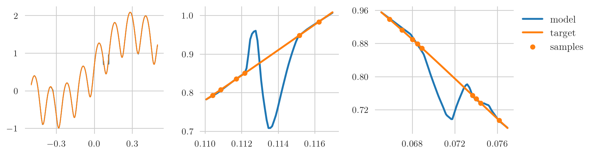

# Scaling Behavior of Physics Informed Neural Networks for Solving PDEs

This is the code for my M.Sc. thesis in Mathematics at the University of Vienna,
[Scaling Behavior of Physics Informed Neural Networks for Solving Partial Differential Equations](https://philippmoehl.github.io/files/ma_thesis.pdf),
supervised by Univ.-Prof. Dr. Philipp Grohs (2023). The thesis introduces
physics-informed neural networks (PINNs) as a regularized learning problem and
measures empirically how their approximation error scales with the number of
training samples, on model PDEs of increasing complexity.

The code extends the experiment framework of
[Accurate Learning with Neural Networks - from Theory to Practice](https://github.com/juliusberner/theory2practice)
by Julius Berner, which is where the repository name comes from.




### What this repository adds to the original framework
* physics-informed neural networks (PINNs), see `PinnAlgorithm` in [`theory2practice/algorithms.py`](theory2practice/algorithms.py)
* PINNs + data method
* periodic PDEs - mentioned in [Characterizing possible failure modes in physics-informed neural networks](
https://arxiv.org/abs/2109.01050)
   * convection
   * diffusion
   * reaction
   * reaction-diffusion
* curriculum learning for PDEs
   * parameter w/ or w/o warmup, linear increasing towards harder PDEs
* sequential grid learning for PDEs
  
## Install

This code was tested with Python 3.9.7. 
All necessary packages are specified in [`requirements.txt`](requirements.txt) and can be installed with:

`pip install -r requirements.txt`.

You can test your setup by running `python main.py`.

If you want to automatically log metrics and plots to [Weights & Biases (W&B)](https://wandb.ai/),
you need to log in:

`wandb login --anonymously`

Omit the flag `--anonymously` if you already have a W&B account. 
The link to the project can be found in the output of the code 
and one can verify this by running `python main.py` again. 

### Conda-Example

Using [(Ana)conda](https://www.anaconda.com), a typical installation with GPU support could look like:
```
conda create --name t2p python=3.9.7 pip -y
conda activate t2p
conda install pytorch=1.11 cudatoolkit=11.3 -c pytorch -y
conda install plotly=5.6.0 -c plotly -y
pip install -r requirements_conda.txt 
```

Usually, one wants to (at least) install `(py)torch` and `plotly` using conda.
The remaining requirements can be found in [`requirements_conda.txt`](requirements_conda.txt).
See [here](https://pytorch.org/get-started/locally/) for more details on the PyTorch installation 
based on compute platform and OS.

## How-To

We specify our experiments using `.yaml` files in the folder [`specs`](specs) 
and we provide specifications for the following experiments:

1. Learning a sinusoidal function:
   
    `python main.py -e specs/1d_sine/exp_0.yaml`

2. One-dimensional teacher-student setting (each experiment uses a different batch-size):

    `python main.py -e specs/1d_5x32/exp_0.yaml`
    
    `python main.py -e specs/1d_5x32/exp_1.yaml`
    
    `python main.py -e specs/1d_5x32/exp_2.yaml`

3. Three-dimensional teacher-student setting (each experiment uses a different batch-size):

    `python main.py -e specs/3d_5x32/exp_0.yaml`
    
    `python main.py -e specs/3d_5x32/exp_1.yaml`
    
    `python main.py -e specs/3d_5x32/exp_2.yaml`

4. PINNs on periodic PDEs:

    `python main.py -e specs/pde_convection/exp_0.yaml`

    `python main.py -e specs/pde_diffusion/exp_0.yaml`

    `python main.py -e specs/pde_reaction/exp_0.yaml`

    `python main.py -e specs/pde_reaction_diffusion/exp_0.yaml`

Note that each training uses a single GPU by default. This can be changed using the key `resources_per_trial` in the
respective experiment specification. You can resume an experiment by adding the flag `-r specs/runner_resume.yaml`.

## Analysis

The Jupyter notebook [`theory2practice.ipynb`](theory2practice.ipynb) shows how to track the experiments on TensorBoard
and provides utility functions to analyse and plot the results.

